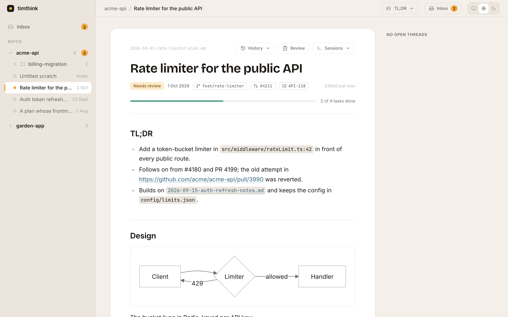

# timthink

A local hub for the markdown plans your coding agents write. Point it at a folder of plans (one subfolder per repo) and it serves a calm, fast reader on `127.0.0.1`: every repo's plans in one sidebar, rendered markdown with diagrams, task progress and links from a plan to the code it cites. You can review a plan like a pull request, see what changed since you last looked, and jump back to the Claude Code session that wrote it.



## Features

- **Reader.** GitHub-flavoured markdown, Mermaid diagrams, syntax highlighting, task progress bars, attachments, and sandboxed HTML `demo` embeds. Live-updates as files change.
- **Links.** Code paths in backticks open in Zed at the right line (resolved against the repo's checkout with `git ls-files`). PR references link to Graphite or GitHub. Sibling plan names link to that plan.
- **Reviews.** Select any passage to comment or suggest an edit, answer ` ```question ` blocks, then submit a verdict. Claude reads and answers the review through the `timthink` CLI, and replies appear live. Threads re-anchor when the plan changes.
- **Changes and inbox.** Each plan shows what changed since you last viewed it (inline word diff, removed blocks, full history). The inbox collects plans that need you across every repo.
- **Sessions.** Claude Code hooks record which sessions wrote which plan, so a plan can focus its live session in Warp or resume a finished one.

Inspired by [Plannotator](https://github.com/backnotprop/plannotator) and [Kacper-Lubisz/pages](https://github.com/Kacper-Lubisz/pages).

## Requirements

- macOS (the background server runs as a launchd agent)
- Node 22 or newer, and pnpm
- Optional: [Claude Code](https://claude.com/claude-code) for sessions and reviews, [Warp](https://www.warp.dev) for focus/resume, [Zed](https://zed.dev) for code links

## Install

```sh
git clone https://github.com/troberts-28/timthink && cd timthink
pnpm install
pnpm build
node cli/dist/main.js install --docs-root ~/agent-docs   # dry run: prints every change
node cli/dist/main.js install --docs-root ~/agent-docs --apply
timthink doctor
```

`install` is a dry run until you pass `--apply`. It prints each step in full (file contents, or a diff for files that exist), is safe to re-run, and refuses to touch files it didn't create. It sets up:

| Component     | Where                                                 | Notes                                                                                   |
| ------------- | ----------------------------------------------------- | --------------------------------------------------------------------------------------- |
| Config        | `~/.config/timthink/config.json`                      | Created from `--docs-root`/`--code-root` if missing; an existing one is never rewritten |
| Node path     | `~/.config/timthink/node-path`                        | The node that ran `install`; used first by `bin/timthink-node` while it exists          |
| CLI shim      | `~/.local/bin/timthink`                               | Runs `cli/dist/main.js` from this checkout                                              |
| Server        | `~/Library/LaunchAgents/dev.timthink.server.plist`    | Starts at login, restarts on crash, logs to `~/Library/Logs/timthink/`                  |
| Skill         | `~/.claude/skills/timthink` → `skill/`                | Teaches Claude the plan conventions and the review workflow                             |
| Claude hooks  | `~/.claude/settings.json`                             | Merged with your hooks; the file is backed up first                                     |

launchd agents and Claude Code hooks don't see the PATH your shell sets up (nvm, for example), so everything runs node through `bin/timthink-node`. It tries `$TIMTHINK_NODE`, the recorded node path, `node` on PATH, your nvm default alias, then Homebrew. Hook commands end in `|| true`, so a missing node or a moved checkout never breaks Claude Code.

`timthink doctor` checks each component and prints a fix for anything missing. `timthink uninstall [--apply]` removes everything except your config, logs and review data.

## Writing plans

```
<docsRoot>/                   # e.g. ~/agent-docs
  <repo>/                     # matches the repo's folder name under codeRoot
    2026-10-01-some-plan.md
    <project>/                # optional grouping
      plan.md
      data/sample.json        # non-markdown files are attachments
```

Frontmatter is optional; `title`, `date`, `status`, `project`, `branch`, `pr` and `linear` are used when present. The conventions Claude follows (where to write, frontmatter, `question` and `demo` blocks, `timthink check`, the review loop) are in [`skill/SKILL.md`](skill/SKILL.md).

## What it reads and writes

| Path                                                   | Access     | Contents                                                                                          |
| ------------------------------------------------------ | ---------- | ------------------------------------------------------------------------------------------------- |
| `<docsRoot>/**`                                        | read       | Your plans and attachments                                                                        |
| `<docsRoot>/<repo>/.timthink/reviews/`, `history/`     | read/write | Review threads, and snapshots for "changes since you last looked"                                 |
| `<docsRoot>/**/*.md`                                   | write      | Only the `status:` line when you submit a verdict, and the text when you accept a suggestion      |
| `~/.local/state/timthink/`                             | read/write | `sessions.jsonl` and `doc-sessions.jsonl` (from hooks), `seen.json`, a transcript backfill cache  |
| `~/.claude/projects/*/*.jsonl`                         | read       | Claude Code transcripts, scanned for plan writes and session titles                               |
| `~/.warp/tab_configs/timthink-resume.toml`             | write      | Written when you click **Resume in Warp**                                                         |

The hooks append one JSON line per event and print nothing:

| Hook                                     | Records                                                                                  |
| ---------------------------------------- | ---------------------------------------------------------------------------------------- |
| `SessionStart`                           | session id, cwd, git branch, transcript path, `$WARP_FOCUS_URL`, `$TERM_PROGRAM`, time   |
| `SessionEnd`                             | session id, end reason, time                                                             |
| `PostToolUse` (`Write\|Edit\|MultiEdit`) | session id and file path, only for files inside `docsRoot`                               |

Nothing leaves your machine.

## Security

- The server binds to `127.0.0.1` and rejects requests whose `Host` isn't a loopback name.
- Mutating requests need a same-origin `Origin` header and a per-process token embedded in the served page, so other websites can't post to it.
- Doc paths must resolve inside `docsRoot`; attachments that escape it through symlinks are refused and are served with a sandboxing CSP. `demo` iframes get `allow-scripts` without same-origin access.
- Zed is launched with `execFile` (no shell), and only for files inside the configured code roots.

## Configuration

`~/.config/timthink/config.json` (override with `TIMTHINK_CONFIG`). Every key is optional.

| Key                      | Default                   | Meaning                                                                                     |
| ------------------------ | ------------------------- | ------------------------------------------------------------------------------------------- |
| `docsRoot`               | `~/agent-docs`            | Folder of plans, one subfolder per repo                                                     |
| `codeRoot`               | `~/code`                  | A docs folder `<repo>` maps to the checkout `codeRoot/<repo>`                               |
| `port`                   | `7420`                    | Port on `127.0.0.1` (`TIMTHINK_PORT` overrides)                                             |
| `stateDir`               | `~/.local/state/timthink` | Hook logs and caches (`TIMTHINK_STATE_DIR` overrides)                                       |
| `claudeProjectsDir`      | `~/.claude/projects`      | Transcripts to backfill sessions from                                                       |
| `warpTabConfigDir`       | `~/.warp/tab_configs`     | Where **Resume in Warp** writes its tab config                                              |
| `userName`               | `git config user.name`    | Your name on review comments                                                                |
| `launchdLabel`           | `dev.timthink.server`     | Label of the launchd agent                                                                  |
| `repos.<repo>.host`      | `codeRoot/<repo>`         | The repo's main checkout                                                                    |
| `repos.<repo>.worktrees` | none                      | Glob for extra worktrees (`~/code/my-repo-*`), used to match sessions to the repo           |
| `repos.<repo>.prLinks`   | `graphite`                | Where PR references link: `graphite` or `github`                                            |
| `repos.<repo>.aliases`   | none                      | Other checkout names that `timthink docs-dir` maps to this docs folder                      |

## CLI

| Command                                         | What it does                                                                      |
| ----------------------------------------------- | --------------------------------------------------------------------------------- |
| `timthink serve`                                | Run the hub in the foreground                                                     |
| `timthink url <doc>`                            | Print the hub URL for a plan                                                      |
| `timthink docs-dir [--cwd dir]`                 | Print the docs folder for the current git repo (worktrees like `repo-2` map to `repo`) |
| `timthink check <doc>`                          | Check frontmatter, `question`/`mermaid`/`demo` blocks and relative links          |
| `timthink review list \| show \| reply \| resolve \| answer-ack \| addressed` | Read and answer submitted reviews (`timthink review --help`) |
| `timthink doctor`                               | Check every installed component                                                   |
| `timthink install \| uninstall [--apply]`       | Set up or remove the components above                                             |

## Development

```sh
pnpm dev          # API server (tsx watch) on 7420 and Vite on 5173
pnpm test         # vitest
pnpm typecheck
pnpm lint         # biome
pnpm screenshots --out shots home=/ plan=/d/acme-api/2026-10-01-rate-limiter-plan.md
```

`server/` is the Hono API, indexer, watcher and review store; `web/` is the Vite, React and Tailwind UI; `cli/` is the `timthink` binary; `hooks/` holds the dependency-free hook script; `skill/` is the agent skill. Sample data lives in `fixtures/`.

## Limitations

- macOS only for the installed setup (launchd, Warp, Zed). `pnpm start` runs the hub anywhere Node does.
- Sessions and reviews are built around Claude Code; other agents' plans render but have no session links.
- One user, one machine: there are no accounts, and `seen.json` is per machine even if your plans sync.
- Warp can focus a session only while its pane is open; for a closed pane it does nothing.

## License

[MIT](LICENSE)
