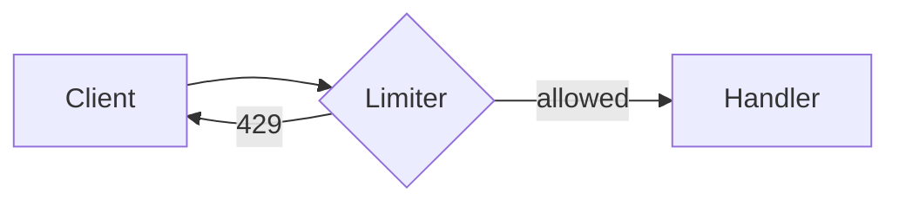

# Rate limiter for the public API

## TL;DR

- Add a token-bucket limiter in `src/middleware/rateLimit.ts:42` in front of every public route.
- Follows on from #4180 and PR 4199; the old attempt in https://github.com/acme/acme-api/pull/3990 was reverted.
- Builds on `2026-09-15-auth-refresh-notes.md` and keeps the config in `config/limits.json`.

## Design



The bucket lives in Redis, keyed per API key:

```ts
export function takeToken(bucket: Bucket, now: number): boolean {
  refill(bucket, now);
  if (bucket.tokens < 1) return false;
  bucket.tokens -= 1;
  return true;
}
```

| Tier | Requests / min | Burst |
|---|---|---|
| Free | 60 | 10 |
| Pro | 600 | 100 |

> **Note** Limits are per key, not per IP.

## Open questions

```question id=burst-policy
How should bursts be handled for the free tier?
- Hard cap at the burst size
- Allow a short grace window (recommended)
- No burst at all
```

## Demo

```demo src=2026-10-01-rate-limiter-demo.html
```

## Tasks

- [x] Spike the token bucket
- [x] Agree the tiers
- [ ] Wire `rateLimit.ts` into the router
- [ ] Load test with `scripts/load/burst.js:12:3`
