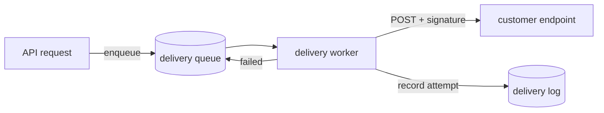

# Reliable webhook delivery

## TL;DR

Customer webhooks are sent inline from the request that triggers them, so a slow receiver slows our API and a failed send is lost. Move delivery onto a queue with retries, signing and a delivery log customers can inspect.

## Current state

- `src/webhooks/send.ts:31` posts the payload synchronously with a 10s timeout.
- Failures are logged and dropped; there's no retry and no record of what was sent.
- The rate limiter from 2026-10-01-rate-limiter-plan.md already gives us a Redis connection to reuse.

## Design



## Decisions

```question id=retry-schedule
How should failed deliveries be retried?
- Exponential backoff for 24 hours (recommended)
  Recovers from long outages; a dead endpoint costs ~15 attempts.
- Fixed schedule: 1m, 5m, 30m, then give up
  Simple and predictable, but misses outages longer than an hour.
- No automatic retries, manual resend only
  Least load, but every blip becomes a support ticket.
---
### Context

Today a failed send is gone for good (`src/webhooks/send.ts:31`). Support handled 14 "missing webhook" tickets last month, nearly all from receivers that were down for under two hours. Whatever we pick sets the worker's load profile and what the delivery log has to show.

### Options

**Exponential backoff for 24 hours.** Starts at 30s, doubles to a 2h cap. Pros: covers deploys and most outages; it's the schedule most payment providers use, so customers expect it. Cons: a permanently dead endpoint costs about 15 attempts before we disable it. Effort: small, the queue supports delayed jobs.

**Fixed schedule.** Pros: easy to explain in the docs. Cons: an outage longer than 36 minutes still loses events. Effort: small.

**Manual resend only.** Pros: no extra load. Cons: pushes the work onto customers and support. Effort: smallest, but the resend UI is needed anyway.

### Recommendation

Exponential backoff for 24 hours, then mark the endpoint as failing and email the account owner. Switch to the fixed schedule if worker load from dead endpoints shows up in the queue metrics after a month.
```

````question id=signing
How should payloads be signed?
- HMAC-SHA256 with a per-endpoint secret (recommended)
  Standard and cheap to verify; secrets need a rotation story.
- Asymmetric signatures (Ed25519)
  No shared secret to leak, but fewer customers know how to verify.
---
### Context

Receivers can't tell our requests from forged ones today. Signing has to work for customers writing a ten-line handler in any language, and it ties into how secrets are stored in `src/webhooks/endpoints.ts`.

### Options

**HMAC-SHA256.** Pros: every language has it in the standard library; matches what customers already do for other providers. Cons: we store a secret per endpoint and need overlapping secrets during rotation. Risk: low.

**Ed25519.** Pros: nothing secret leaves our side, one public key for everyone. Cons: harder to verify in some runtimes; more support questions.

The header would look like this either way:

```http
Acme-Signature: t=1730800000,v1=5257a869e7ecebeda32affa62cdca3fa51cad7e77a0e56ff536d0ce8e108d8bd
```

### Recommendation

HMAC-SHA256 with a timestamp in the signed string to block replays, and two active secrets per endpoint during rotation. Revisit asymmetric signing if we ever need third parties to verify payloads they didn't receive directly.
````

```question id=log-retention
How long should the delivery log keep payloads?
- 30 days (recommended)
  Covers a billing cycle of debugging; storage stays small.
- 7 days
  Cheapest, but too short for month-end reconciliation.
- 90 days
  Matches the audit log, roughly triples storage.
---
### Context

The delivery log stores each attempt's request, response code and body so customers can debug their endpoints. Payloads can contain customer data, so retention is also a privacy decision. See PR #4290 for the storage estimate.

### Options

**30 days.** Pros: covers month-end reconciliation, which is when most "did you send it?" questions arrive. Cons: none significant at current volume.

**7 days.** Pros: smallest table. Cons: too short for the reconciliation case.

**90 days.** Pros: lines up with the audit log. Cons: about three times the storage, and longer exposure of customer data.

### Recommendation

30 days, with metadata (status codes, timings) kept for 90 days without the bodies. Go longer only if a customer contract requires it.
```

```question id=dashboard-placement
Where should the delivery log live in the dashboard?
- Under each endpoint's settings page
- A new top-level "Webhooks" page (recommended)
```

## Rollout

1. Ship the queue and worker behind `webhooks_v2`, dark-sending to a test endpoint.
2. Turn it on for internal accounts, then 10% of customers.
3. Remove the inline sender.

## Tasks

- [ ] Delivery queue and worker
- [ ] Retry schedule
- [ ] Signing and secret rotation
- [ ] Delivery log API
- [ ] Dashboard page
